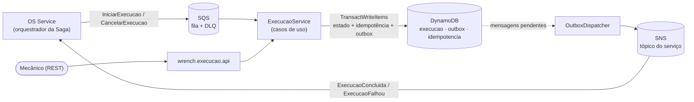

# Wrench Execução Service

Microsserviço responsável pela **fila de execução** das ordens de serviço aprovadas: recebe a
ordem para executar, controla o reparo (pendente → em execução → concluída) e devolve o resultado
para a Saga, que é orquestrada no OS Service.

- **Linguagem/Framework:** .NET 10 / ASP.NET Core, Clean Architecture (`domain` / `application` / `infra` / `api`)
- **Banco:** Amazon DynamoDB (NoSQL, on-demand) — nenhum acesso a banco de outro serviço
- **Mensageria:** Amazon SNS (publicação, via outbox transacional) e SQS (consumo, com DLQ)
- **Autenticação:** JWT (mesmo emissor/segredo da Lambda de autenticação)
- **Observabilidade:** Serilog (JSON) + OpenTelemetry → New Relic, `X-Correlation-ID` e `traceparent`

## Arquitetura



### Consistência e idempotência

- **Outbox transacional:** o novo estado da execução e os eventos de saída são gravados na mesma
  `TransactWriteItems`; o `OutboxDispatcher` publica no SNS e marca como publicada. Se a
  publicação falhar, a mensagem continua pendente e é tentada de novo.
- **Consumidores idempotentes:** cada mensagem consumida grava seu `messageId` na tabela
  `wrench-execucao-idempotencia` (com TTL) **na mesma transação** da mudança de estado; uma
  mensagem repetida é reconhecida e ignorada.
- **Concorrência otimista:** cada execução tem um campo `versao`; a gravação exige a versão lida.
  Duas operações simultâneas na mesma execução resultam em `409 Conflict` para a segunda.

## Eventos

| Mensagem | Direção | Campos |
|---|---|---|
| `IniciarExecucao` | consome | `ordemServicoId, correlationId, descricao, itens[], valorAprovado` |
| `CancelarExecucao` | consome (compensação) | `ordemServicoId, correlationId, motivo` |
| `ExecucaoConcluida` | publica | `ordemServicoId, correlationId, concluidaEm` |
| `ExecucaoFalhou` | publica | `ordemServicoId, correlationId, motivo` |

Atributos de mensagem SNS: `messageId`, `tipo`, `correlationId`, `traceparent`.

Compensação: `CancelarExecucao` remove da fila uma execução pendente ou em andamento
(`Removida`). Se não houver execução, é um no-op; se já foi concluída, é conflito.

## API (`/api/v1/execucoes`)

Roles `Admin` ou `Funcionario`. Documentação interativa em `/docs-ui` (OpenAPI em `/openapi/v1.json`)
e collection Postman em [`docs/postman/execucao-service.postman_collection.json`](docs/postman/execucao-service.postman_collection.json),
com as variáveis `baseUrl`, `token` e `ordemServicoId`.

| Método | Rota | Descrição |
|---|---|---|
| GET | `/` | Lista a fila por status (`?status=Pendente&limite=50`), da mais antiga para a mais nova |
| GET | `/{ordemServicoId}` | Consulta a execução |
| POST | `/{ordemServicoId}/assumir` | O mecânico assume (corpo opcional `{ "mecanico": "..." }`; padrão: usuário do token) |
| POST | `/{ordemServicoId}/concluir` | Conclui e publica `ExecucaoConcluida` |
| POST | `/{ordemServicoId}/falhar` | **Demo:** força a falha e publica `ExecucaoFalhou`. Somente `Admin` e somente com `Execucao:PermitirFalhaForcada=true` (404 caso contrário) |

Health: `/health` (liveness) e `/health/ready` (consulta o DynamoDB).

## Modelo de dados (DynamoDB)

| Tabela | Chave | Índice | Observação |
|---|---|---|---|
| `wrench-execucao` | `ordemServicoId` (S) | `status-enfileiradaEm` (status, enfileiradaEm) | Itens/valores da execução e `versao` |
| `wrench-execucao-outbox` | `id` (S) | `status-criadoEm` (status, criadoEm) | Mensagens de saída pendentes/publicadas |
| `wrench-execucao-idempotencia` | `messageId` (S) | — | TTL em `ttl` (7 dias) |

Em AWS as tabelas são provisionadas via Terraform. Localmente, `Dynamo__CriarTabelas=true` cria as três.

## Configuração

| Variável | Descrição |
|---|---|
| `JwtOptions__Secret` / `__Issuer` / `__Audience` | Validação do JWT (**obrigatório**; mesmo segredo da Lambda) |
| `Dynamo__Execucao` / `__Outbox` / `__Idempotencia` | Nomes das tabelas |
| `Dynamo__ServiceUrl` / `Dynamo__CriarTabelas` | Somente desenvolvimento (DynamoDB Local) |
| `Sns__TopicArn` | Tópico onde os eventos são publicados |
| `Outbox__IntervaloSegundos` / `Outbox__TamanhoLote` | Frequência e tamanho do lote do dispatcher |
| `Execucao__PermitirFalhaForcada` | Habilita `/falhar` (nunca em produção) |
| `AWS__Region` | Região (credenciais via IRSA em produção) |
| `OTEL_EXPORTER_OTLP_ENDPOINT` / `_PROTOCOL` / `_HEADERS` | Exportação para o New Relic (sem elas, nada é exportado) |

Nenhum segredo é versionado.

## Como rodar

```bash
# Local com DynamoDB Local (API em http://localhost:8081/docs-ui)
docker compose up --build

# Ou direto, apontando para um DynamoDB Local já em execução
Dynamo__ServiceUrl=http://localhost:8000 Dynamo__CriarTabelas=true \
JwtOptions__Secret=<segredo-com-32+-caracteres> \
dotnet run --project src/wrench.execucao.api
```

## Testes e cobertura

```bash
dotnet test --collect:"XPlat Code Coverage" --settings tests/wrench.execucao.tests/coverage.runsettings
reportgenerator "-reports:tests/**/coverage.cobertura.xml" "-targetdir:coverage-report" "-reporttypes:TextSummary;Html"
```

Cobertura atual: **97% de linhas / 91% de ramos** (meta: ≥ 80%). `Program.cs` e código gerado pelo
compilador ficam fora da métrica. O CI falha abaixo de 80%.

## Deploy

Imagem: `Dockerfile` (multi-stage). Chart Helm em [`chart/`](chart): cria Deployment, Service, HPA,
ServiceAccount (IRSA), Secrets e a rota `/api/v1/execucoes` no Gateway compartilhado `bgt3-gw`.
Namespace e Gateway **não** pertencem a este chart.

```bash
helm upgrade --install wrench-execucao ./chart -n production \
  --set image.repository=<ECR>/wrench/execucao-api --set image.tag=<TAG> \
  --set jwt.secret=<SEGREDO> --set sns.topicArn=<ARN> \
  --set serviceAccount.roleArn=<ROLE_IRSA> --set newRelic.licenseKey=<LICENSE_KEY>
```

## Pendências conhecidas

- **Transporte de mensagens:** as mensagens de entrada (`IniciarExecucao`/`CancelarExecucao`) são
  processadas por `ExecucaoService.IniciarAsync/CancelarAsync`, já com idempotência. A ligação com a
  fila SQS (consumers do MassTransit 8.x) depende do pacote `Wrench.Contracts` v1 e da fila/DLQ
  provisionadas; os contratos locais em `application/Contracts` serão trocados pelo pacote.
- **Infraestrutura AWS:** tabelas, tópico/fila, ECR e role IRSA são provisionados via Terraform fora
  deste repositório.
